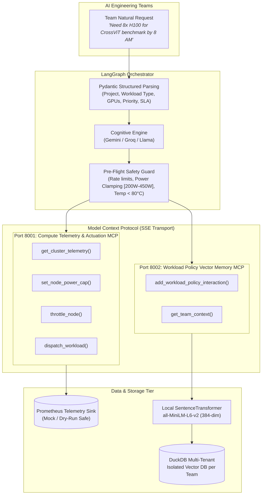
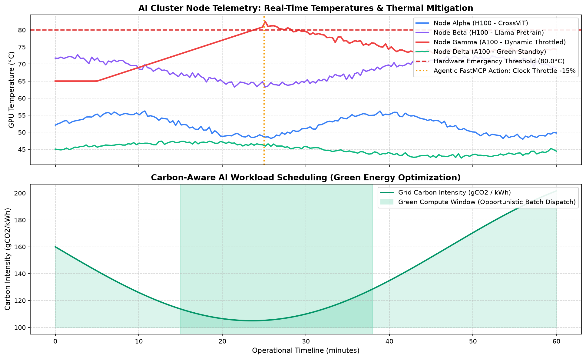

# 🖥️ Agentic Green AI Data Center Orchestrator (FastMCP + LangGraph + DuckDB)

[](https://www.python.org/downloads/)
[](https://modelcontextprotocol.io/)
[](https://langchain-ai.github.io/langgraph/)
[](https://duckdb.org/)
[](LICENSE)

> **Production-grade reference implementation** decoupling physical high-performance compute actuation (GPU power capping, frequency throttling, workload dispatch) and semantic team SLA memory through a **dual FastMCP microservice architecture** coordinated by **LangGraph**.

---

## 📌 Context & Engineering Vision

Modern AI hyperscale data centers operate on two fundamentally different frequencies:
1. **The Fast Physical Telemetry Loop (Deterministic & Real-Time):** GPU temperatures (°C), instantaneous power draw (Watts / TDP limit), server fan curves, dynamic clock throttling, and grid carbon intensity ($g\text{CO}_2/\text{kWh}$).
2. **The Slow Semantic Loop (Business & Multi-Tenant Context):** Engineering team workload requests (*"Urgent 8x H100 GPU allocation for CrossViT training before 8 AM tomorrow"*), contractual SLAs, priority tiers, and historical scheduling policies.

This repository provides an **open-source, resilient agentic bridge** built on Anthropic's **Model Context Protocol (MCP)**. By strictly compartmentalizing hardware actuators and team policy memory into dedicated microservices, the system guarantees **zero unauthorized power overrides**, deterministic JSON contract responses, and multi-tenant vector isolation.



---

## 📊 Telemetry & Thermal Mitigation Benchmark

The timeline below illustrates the closed-loop autonomous response of the FastMCP agent during an intense thermal surge on `node-gamma` ($T > 80^\circ\text{C}$), triggering automatic clock throttling (-15%) to restore safe operating temperatures while scheduling opportunistic batch workloads during low-carbon grid energy windows:

<p align="center">
  
</p>

---

## ⚡ Key Architectural Features

- **Dual-Server MCP Microservices (SSE Transport):**
  - **Port 8001 (`compute_telemetry_server.py`)**: Exposes live cluster telemetry (GPU temperatures, power draw Watts, PUE, grid carbon intensity) and safe actuation commands (dynamic power capping, clock throttling, job dispatch).
  - **Port 8002 (`workload_policy_server.py`)**: Manages multi-tenant semantic vector memory per engineering team.
- **Strict JSON Contract Interface:** Every tool returns an immutable, strongly-typed JSON envelope (`execution_status`, `system_context`, `db_trace`) preventing client parsing crashes.
- **Multi-Tenant Vector Isolation:** Team policies and SLA history are encapsulated in individual DuckDB database files (`data_policies/team_<team_id>.db`) preventing cross-tenant data leakage.
- **Vector Search with Zero External Dependencies:** Cosine similarity computed via vectorized NumPy operations using local 384-dimensional embeddings (`all-MiniLM-L6-v2`) with deterministic fallback.
- **Cyber-Physical Safety Guard:**
  - 30-second rate-limiting cooldown per compute node.
  - Power capping clamped strictly to hardware safety bounds ($[200\text{ W}, 450\text{ W}]$).
  - Thermal dispatch abort trigger when node temperature exceeds $80.0^\circ\text{C}$.
  - Built-in `DRY_RUN` mode for cloud and CI execution without physical GPU clusters.

---

## 📂 Repository Structure

```text
├── .env.example                     # Environment template (Zero private credentials)
├── pyproject.toml                   # Project metadata and dependencies
├── requirements.txt                 # Pinned dependencies
├── Dockerfile                       # Production multi-stage Docker container
├── docker-compose.yml               # Multi-container orchestration (FastMCP + Web UI)
├── README.md                        # Architectural documentation
├── src/
│   ├── config.py                    # Centralized settings & DRY_RUN configuration
│   ├── app.py                       # Interactive Streamlit Web Console & Visualizer
│   ├── mcp_servers/
│   │   ├── compute_telemetry_server.py   # FastMCP Compute & Actuation Server (Port 8001)
│   │   └── workload_policy_server.py     # FastMCP Policy Memory & Vector Server (Port 8002)
│   ├── agents/
│   │   ├── schemas.py               # Pydantic structured output models
│   │   ├── orchestrator.py          # LangGraph state graph for cluster telemetry reasoning
│   │   └── workload_agent.py        # LangGraph state graph for workload parsing & SLA RAG
│   └── utils/
│       └── db_manager.py            # DuckDB multi-tenant context manager
├── scripts/
│   ├── seed_workload_policies.py    # Generates synthetic mock profiles (Zero NDA data)
│   └── run_servers.py               # Concurrent FastMCP dual server launcher
└── tests/
    ├── test_contracts.py            # Validates JSON response contract stability
    ├── test_memory.py               # Tests isolated DuckDB lifecycle & vector similarity
    ├── test_workload_intentions.py  # Tests Pydantic validation & safety bounds
    └── test_runner.py               # Standalone end-to-end test runner
```

---

## 🚀 Quickstart

### 1. Installation

```bash
git clone https://github.com/quentin-jean-pro/agentic-datacenter-mcp.git
cd agentic-datacenter-mcp

# Create and activate virtual environment
python -m venv .venv
source .venv/bin/activate  # On Windows: .venv\Scripts\activate

# Install dependencies
pip install -r requirements.txt
cp .env.example .env
```

### 2. Seed Mock Policies & SLAs

```bash
python scripts/seed_workload_policies.py
```

### 3. Launch the FastMCP Microservices

```bash
python scripts/run_servers.py
```
- Server 1 (Compute Telemetry): `http://localhost:8001/sse`
- Server 2 (Workload Policy): `http://localhost:8002/sse`

### 4. Run the Agentic Orchestrator

```bash
python src/agents/orchestrator.py
python src/agents/workload_agent.py
```

### 5. Launch the Interactive Web Dashboard

Launch the live Streamlit management console to interact with GPU clusters, submit natural language prompts, and trigger FastMCP safety mitigations:

```bash
streamlit run src/app.py
```
Access the application at `http://localhost:8501`.

### 6. Production Deployment with Docker Compose

Deploy the complete multi-service stack (Compute MCP on 8001, Policy MCP on 8002, and Web Dashboard on 8501) with a single command:

```bash
docker compose up --build
```

---

## 🧪 Automated Testing

Run the test suite offline with Pytest:

```bash
pytest tests/ -v
# Or run the standalone zero-dependency test runner:
python tests/test_runner.py
```

---

## 📜 License

Distributed under the **MIT License**. See `LICENSE` for details.
